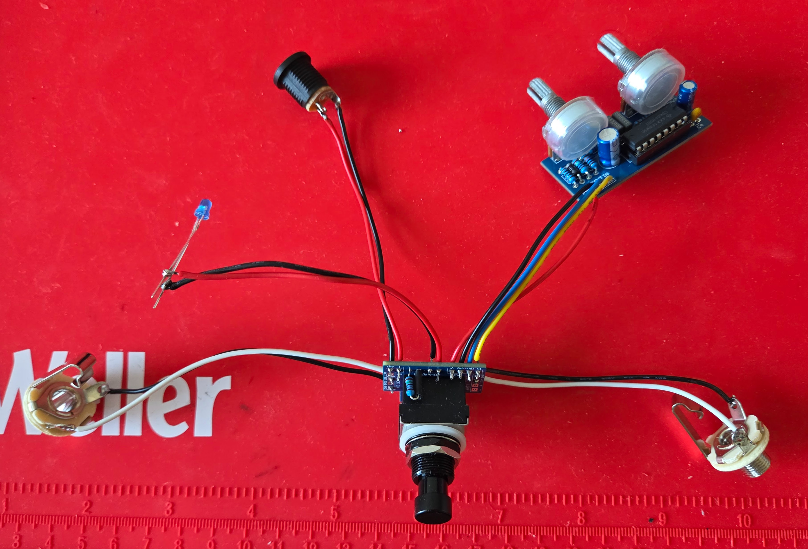
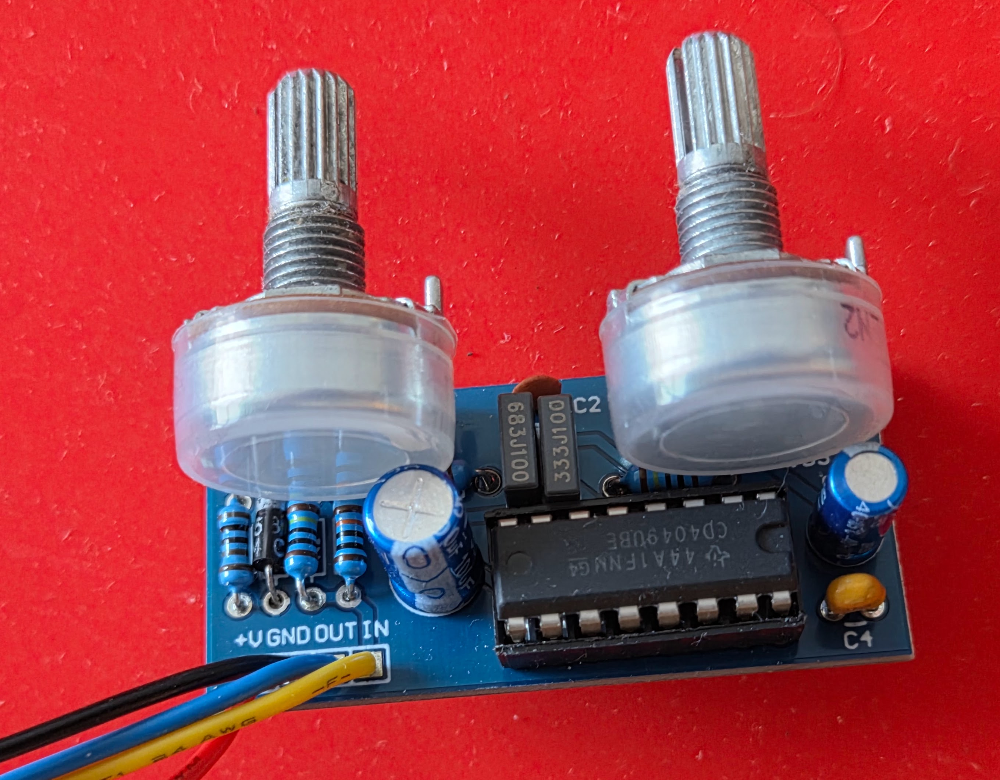
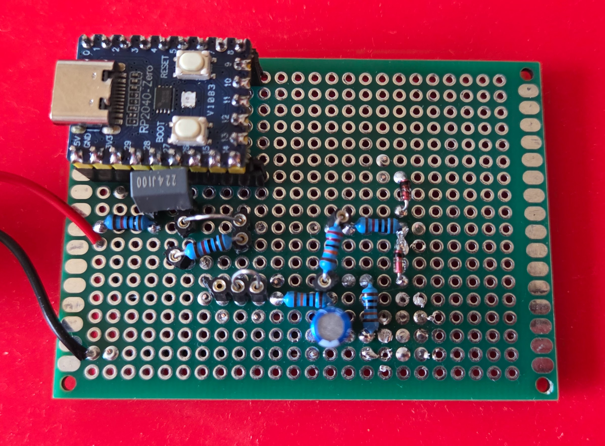
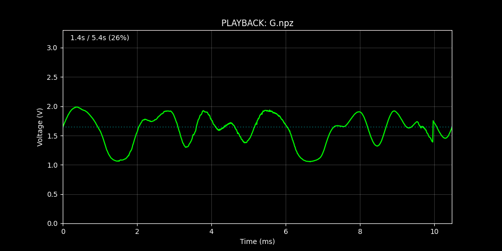

<!-- markdownlint-disable-file MD041 -->
<div align="center">

# Systems Audio Lab

**An audio measurement chain built from scratch: power supply, guitar pedal, oscilloscope and analysis code.**


[](https://github.com/astral-sh/ruff)
[](https://mypy-lang.org/)
[](https://github.com/j178/prek)
[](LICENSE)

</div>

## 📡 Overview

Most audio measurement uses commercial equipment whose internals you can't inspect. This project builds every stage of the signal chain instead:

1. **Power:** A custom linear regulator to keep switching noise off the pedal's supply.
1. **Device:** A discrete CMOS overdrive circuit to generate soft-clipping distortion.
1. **Probe:** A custom RP2040 oscilloscope to capture the waveform.
1. **Analysis:** A Python pipeline to measure the transfer function and harmonic distortion.

Because each stage is built and documented here, the measured distortion can be traced back to specific parts of the circuit rather than to unknown equipment.

---

### 📄 [Read the Full Engineering Report (PDF)](https://raw.githubusercontent.com/JacksonFergusonDev/systems-audio-lab/main/docs/systems_audio_tech_report.pdf)

*The full write-up: parts ordering, power supply design, building the pedal, and building and calibrating the oscilloscope used to measure it.*

---

## 🔬 Signal Analysis: Quantifying "Warmth"

The main question was whether CMOS inverter chips (normally used for digital logic), when biased into their linear region, produce soft-clipping distortion similar to vacuum tubes.

**The Results:**
Using the custom RP2040 oscilloscope, I captured the saturation behavior of the Red Llama overdrive circuit.


1. **Time Domain (Left):** Shows "soft knee" compression. Diodes clip sharply at their forward voltage $V_f$; the CMOS chips round off the waveform smoothly instead.
1. **Frequency Domain (Right):** The circuit shifts the guitar's harmonics towards even orders (2nd harmonic up, 3rd down; the even/odd energy ratio rises from 1.05 to 1.88). With a pure 1 kHz tone the shift is smaller: the 2nd and 3rd harmonics are equal, and the even harmonics lead only from the 4th up (even/odd ratio 1.34). This fits the asymmetric clipping behind the "tube sound" idea, but the circuit does not produce a dominant 2nd harmonic.

---

## 🏗 System Architecture

This project consists of four interconnected subsystems, each enabling the next.

### 1. [Logistics: Star Ground](https://github.com/JacksonFergusonDev/star-ground)

- **The Problem:** Working out what to order by hand from a PDF bill of materials (BOM) led to missing parts and delays.
- **The Solution:** A tool that reads PDF BOMs, subtracts parts already on hand, and adds spares (safety stock) to the order.
- **Status:** *Complete / External Repository*

### 2. [Infrastructure: Linear Power Regulator](power-regulator-12v-to-9v/)

- **The Problem:** Cheap wall adapters add switching noise (ripple) to the supply, which can leak into the audio.
- **The Solution:** A 12V to 9V linear regulator with a heatsink and vents, sized for loads up to 400 mA. It is meant to remove the switching ripple, but the output ripple has not been measured.
- **Key Components:** L7809CV regulator, Schottky diode for reverse polarity protection, heatsink with ventilation.

### 3. [The Device: Red Llama Overdrive](red-llama-build/)

- **The Problem:** The measurements needed a device under test (DUT) with known, repeatable distortion.
- **The Solution:** A clone of the Red Llama overdrive, which uses a CD4049 CMOS inverter chip.
- **Modification:** Replaced the reverse-polarity diode with a Schottky (1N5817), raising the supply rail by about 0.4V.

 

### 4. [Instrumentation: RP2040 Oscilloscope](oscilloscope-rp2040/)

- **The Problem:** Measuring the pedal's harmonics needed an oscilloscope, and I didn't have one.
- **The Solution:** Built a USB oscilloscope around the RP2040 microcontroller with custom analog signal conditioning.
- **Architecture:** The firmware fills a memory buffer first and sends it over USB afterwards, so USB traffic never interrupts sampling.
- **Performance:** 97.69 kSps (verified against crystal-referenced test tones), 12-bit ADC with 59 dB full-scale dynamic range (9.5 effective bits), 1.3 mV RMS noise floor.

 

---

## 🚀 Getting Started

This project uses **uv** for dependency management.

### 1. Clone & Enter

```bash
git clone https://github.com/JacksonFergusonDev/systems-audio-lab.git
cd systems-audio-lab
```

### 2. Install Environment

The package is installed in editable mode, so changes to the `sysaudio` library show up in the notebooks without reinstalling.

```bash
# Initialize virtual environment
uv venv
source .venv/bin/activate

# Install dependencies and local package
uv pip install -e .
```

### 3. Usage Options

**Option A: Jupyter notebooks.** Open the analysis notebooks:

```bash
jupyter lab
```

**Option B: Command-line scripts.** Run the capture and visualization tools directly:

```bash
# Example: Launch the real-time oscilloscope visualization
python oscilloscope-rp2040/scripts/visualization/live_scope.py

# Example: Record a single burst of data
python oscilloscope-rp2040/scripts/capture/record.py
```

---

## 📂 Repository Structure

```text
.
├── docs/                      # Engineering Report (LaTeX/PDF) & Analysis Figures
├── oscilloscope-rp2040/       # Firmware (MicroPython) & Analysis Pipeline
│   ├── firmware/              # RP2040 Sampling Logic
│   ├── notebooks/             # Jupyter Analysis Notebooks
│   │   ├── 01_instrument_acquisition.ipynb  # Waveform Capture
│   │   ├── 02_instrument_analysis.ipynb     # Harmonic Analysis
│   │   ├── 03_transfer_acquisition.ipynb    # Sine Sweep Generation
│   │   └── 04_transfer_analysis.ipynb       # Transfer Function Analysis
│   ├── sysaudio/              # Analysis Library (FFT, Plotting, Signal Processing)
│   └── schematics/            # Signal Conditioning Circuit Design
├── red-llama-build/           # Guitar Overdrive Test Circuit
│   └── procurement/           # Bills of Materials
└── power-regulator-12v-to-9v/ # Linear Power Supply Design
```

---

## 🔮 Future Roadmap: Silicon Revision (v1.0)

With the measurement chain validated, the next version aims for exact sample timing and automated measurements.

**Current State:** The v0 prototype sends data over USB serial, polled by the CPU. Its timing depends on the host operating system, and continuous captures have untimed gaps between 1,024-sample blocks.

**The Goal:** A custom PCB where samples move from the converter to the network without the CPU copying them (a **zero-copy architecture**), so sample timing comes from hardware clocks, not software loops.

### Planned Improvements

#### 1. Network Transport (Ethernet vs USB)

- **The Problem:** USB timing is set by the host: the device must wait for the operating system to poll it (every 125 µs to 1 ms).
- **The Fix:** Implement an **Ethernet PHY (W5500/LAN8720)**.
- **The Result:** The device sends data over UDP as soon as it is captured, so the host's scheduler no longer affects sampling.

#### 2. Zero-Copy DMA Architecture

- **The Problem:** Moving data from the ADC to memory with the CPU uses cycles and can drop samples under load.
- **The Fix:** Implement a **Direct Memory Access (DMA)** pipeline.
- **The Result:** The ADC writes directly to a ring buffer in RAM, and a second DMA channel feeds the Ethernet controller. The CPU never touches the sample data, so CPU load can't disturb sampling.

#### 3. Signal Chain Upgrade

- **External ADC:** Replace the RP2040's internal 12-bit ADC with a 24-bit audio codec (I2S), to measure quieter harmonics (target noise floor: −90 dB).
- **On-board DAC:** Add a DAC (PCM5102) so the instrument generates its own test signals and sweeps without a laptop sound card.

#### 4. Programmable Input Stage

- **Software-Controlled Gain:** Replace manual jumpers with a Programmable Gain Amplifier (PGA).
- **Automated Characterization:** A "one-click Bode plot": the system plays a sweep, captures the response with DMA and streams it over UDP, with no manual steps.

---

## Contact

[](https://github.com/JacksonFergusonDev)
[](https://www.linkedin.com/in/jackson--ferguson/)
[](mailto:jackson.ferguson0@gmail.com)

[](https://jacksonferguson.me)

---

## 📄 License

This project is licensed under the MIT License. See the [LICENSE](LICENSE) file for details.
