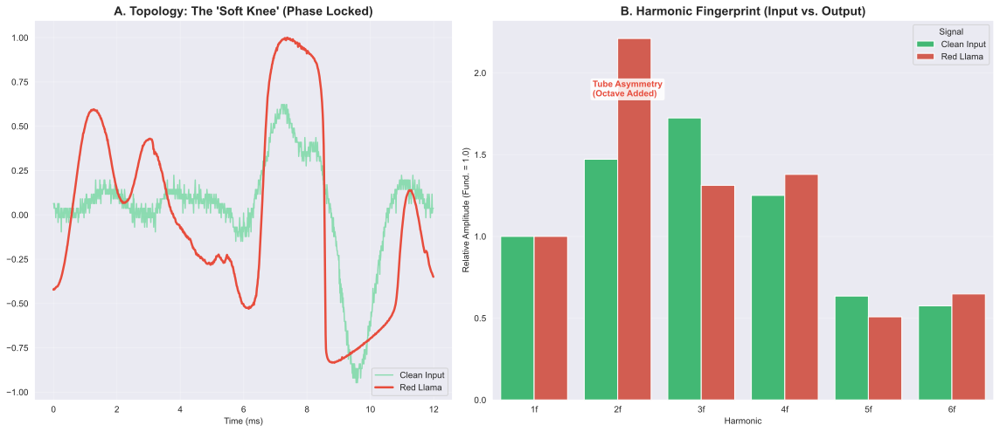
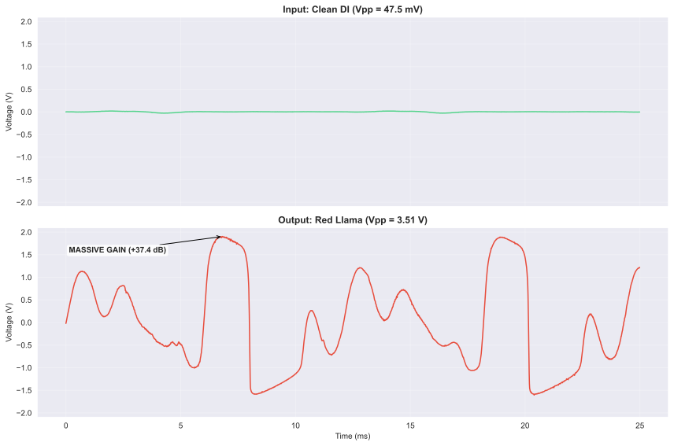
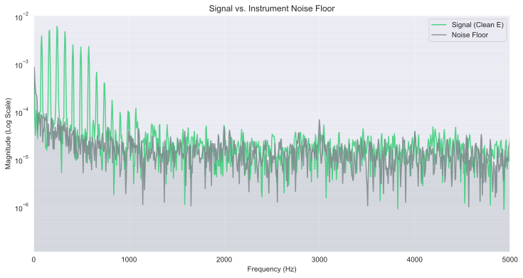
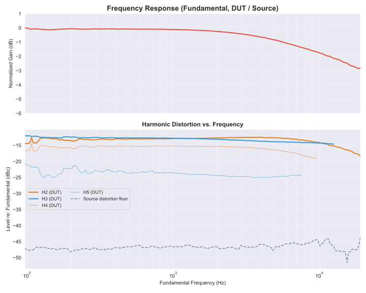

# Technical Report: From Python to Silicon

**[📄 Read the Full Engineering Report (PDF)](./systems_audio_tech_report.pdf)**

This directory contains the formal technical documentation for the **Universal RP2040 Analog Interface** and its associated subsystems. It serves as a comprehensive Systems Engineering Technical Report, detailing the recursive journey of building the software to buy the parts, building the power supply to run the device, and building the instrumentation to validate it.

---

## 1. The Engineering Narrative

The core objective of this project was to bridge the "Full-Stack Gap" between high-level software architecture and physical layer implementation. Rather than purchasing off-the-shelf components, four distinct systems were engineered to support one another:

1. **Logistics (Star Ground):** A Python-based BOM engine to solve the procurement problem.
1. **Infrastructure (Linear Regulator):** A thermal-managed 12V $\to$ 9V supply to establish a low noise floor.
1. **Device Under Test (Red Llama):** A CMOS Hex Inverter-based overdrive circuit.
1. **Instrumentation (RP2040 DAQ):** A custom **FFT Spectrum Analyzer** used to empirically validate the DUT.

## 2. Key Findings

The final analysis (detailed in **Chapter 6** of the report) successfully validated the "Tube-like" behavior of the CD4049 CMOS topology.

### A. Topology Confirmation (Soft Clipping)

- **Hypothesis:** CMOS inverters, when biased linearly, exhibit "Soft Knee" compression rather than the hard-clipping characteristic of silicon diodes.
- **Result:** Confirmed. The transfer characteristic follows a continuous **Hyperbolic Tangent ($\tanh$)** curve. The frequency domain (Right) reveals a dominant **2nd Harmonic (Octave)**, mathematically consistent with vacuum tube triode asymmetry.

### B. Signal Gain & Dynamic Range

- **Measurement:** The Red Llama circuit provides approximately **37dB** of gain ($72\times$, peak-to-peak), with the Red Llama capture corrected for the DAQ's 0.5× input divider.
- **Mechanism:** The circuit amplifies the 49mVpp instrument signal to 3.54Vpp, deep into the saturation of its CMOS inverters. The density of the waveform below visualizes this massive amplification factor.

### C. System Sensitivity (Noise Floor)

- **Validation:** With the input open, mains pickup is negligible (a 60Hz line of ~0.05mV against 1.3mV of broadband noise).
- **Metric:** The DAQ achieved a read noise of **1.29mV RMS** (confirmed within 1% by an independent hum-residual measurement), giving a full-scale dynamic range of **59.1dB** (9.5 effective bits).

---

### D. Transfer Function (Phase II)

- **Method:** The Red Llama was driven by a 20Hz-20kHz log sine sweep from the host DAC (`scripts/signal/play_sweep.py`). Because stream-mode captures have gaps between 1024-sample blocks, the response was recovered by per-block harmonic fitting (`sysaudio.chunked_sweep`) rather than ESS deconvolution.
- **Result:** At max gain the response is flat within 0.5dB from 97Hz to 3.4kHz, rolling off to -2.8dB at 19.1kHz. Distortion is heavy and frequency-independent (H2 ≈ H3 ≈ -13dBc), over 30dB above the measurement chain's floor, and cross-validated against a burst capture within 0.2dB. Across H2-H8 the even harmonics carry 1.34× the energy of the odd ones for a pure 1kHz tone, confirming asymmetric clipping.

## 3. Artifacts

- **`systems_audio_tech_report.tex`**: The LaTeX source code for the technical report.
- **`figures/`**: Generated matplotlib exports from the analysis pipeline.
- **`systems_audio_tech_report.pdf`**: The compiled documentation.
