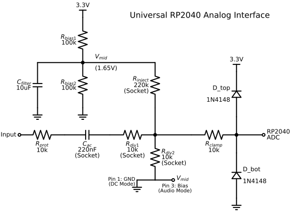

# Universal RP2040 Spectrograph & Oscilloscope

**Status:** Commissioned (Jan 2026) | **Version:** v0 prototype, with Phase 2 transfer function analysis

This project turns a Waveshare RP2040-Zero into a calibrated data acquisition (DAQ) device for audio and spectrum analysis. Beyond the microcontroller's built-in ADC, it adds an analog front end (AFE), the circuit between the input jack and the ADC, which scales, biases and clamps the signal. The firmware captures a full burst into memory before sending anything over USB ("store-and-forward"), so USB delays can't disturb sampling.

In Phase 2, the laptop gained a function generator (using its sound card) and transfer function analysis, so the system can drive a circuit and measure its response: Bode plots, linearity tests and total harmonic distortion (THD).



*A more detailed version of the schematic, with an explanation of the circuit, is in the [schematic documentation](./schematics/README.md).*

## ⚡ System Specifications

| Parameter | Performance |
| :--- | :--- |
| **ADC Depth** | 12-bit (Hardware) $\to$ 16-bit (Scaled) |
| **Sample Rate ($F_s$)** | **97.69 kHz** ±0.01% (verified against crystal-referenced test tones) |
| **Bandwidth** | DC -- 48.8 kHz (Nyquist) |
| **Buffer** | 16,384 Samples ($\approx 168$ms burst) |
| **Noise Floor** | 1.29 mV RMS; 59.1 dB full-scale dynamic range (9.5 effective bits) |
| **Input Range** | 0--3.3V (Unipolar) / $\pm 3.3V$ (AC Coupled) |

## 📂 Repository Architecture

### [`schematics/`](./schematics/)

The hardware: schematics and fabrication exports for the analog front end.

- **Topology:** A jumper selects the divider's reference, with socketed resistors to set attenuation (line level or high-impedance guitar input).
- **Protection:** A series resistor ($R_{prot}$) and two 1N4148 clamp diodes keep the input within the RP2040's safe range.

### [`firmware/`](./firmware)

The MicroPython program running on the microcontroller.

- **Engine:** The sampling loop is compiled to machine code with `@micropython.native`, which makes it fast and keeps its timing steady.
- **Protocol:** The host sends a one-byte command (`s` for a full "science" burst, `v` for a short "video" burst) and the device replies with raw samples, so it never sends faster than the host reads.

### [`sysaudio/`](./sysaudio)

The Python library backing the analysis pipeline.

- **Core & Hardware**
  - `sysaudio.daq`: Talks to the device over USB serial.
  - `sysaudio.calibration`: Measures the true sample rate ($F_s$).
  - `sysaudio.audio`: Host-side signal generation (Sine, Square, Log Sweeps) via `sounddevice`.
- **Experimentation**
  - `sysaudio.experiments`: Automated captures used by the notebooks (linearity, bandwidth, THD).
  - `sysaudio.io`: Saves and loads burst and continuous captures (`.npz`).
- **Analysis & Viz**
  - `sysaudio.dsp`: Signal processing (FFT, THD, triggering).
  - `sysaudio.plots`: The report's figures (Bode plots, transfer curves, harmonic profiles).
  - `sysaudio.viz`: Plotting for the live oscilloscope.

### [`scripts/`](./scripts)

Command-line tools.

- **`capture/`**: Headless recording tools.
  - `record.py`: Captures one 16,384-sample burst.
  - `master_transfer.py`: Plays a test signal and records the response (sweep or steady tone).
  - `stream.py`: Continuous data streaming utility.
- **`signal/`**: Interactive function generators.
  - `play_wave.py`: Plays a continuous waveform and shows the live scope.
  - `play_sweep.py`: Logarithmic sine sweep generator.
- **`visualization/`**: Monitoring and rendering.
  - `live_scope.py`: Real-time oscilloscope with FFT.
  - `playback_scope.py`: Offline replay of captured signal files.
  - `joyplot.py`: Ridge-line plot generation for spectral waterfalls.
  - `render_scope_video.py`: Exports scope data to video frames.
- **`fun/`**: Visual experiments.
  - `neon_torus.py`: XY oscilloscope visualization.
  - `render_landscape.py`: Renders audio data as a 3D landscape. It made the title graphic for [systems_audio_tech_report.pdf](../docs/systems_audio_tech_report.pdf).

### [`notebooks/`](./notebooks)

The analysis, step by step.

- **`01_instrument_acquisition.ipynb`**: Hardware calibration and raw data inspection.
- **`02_instrument_analysis.ipynb`**: Measures the Red Llama overdrive with guitar signals (gain, harmonics, clipping shape).
- **`03_transfer_acquisition.ipynb`**: Automated capture of transfer function datasets.
  - *Set A:* Linearity (Triangle Wave).
  - *Set B:* Bandwidth (Log Sine Sweep).
  - *Set C:* Standard THD (1kHz Sine).
- **`04_transfer_analysis.ipynb`**: Analyzes the test-signal captures.
  - *Bode Response:* Magnitude response and harmonics vs. frequency (chunked sweep fitting).
  - *Transfer Curves:* Output plotted against input, showing where the circuit stops being linear.
  - *THD Fingerprinting:* The level of each harmonic.

## Hardware Requirements

**Total Cost:** ~$4.14 USD

| Qty | Component | Notes |
| :--- | :--- | :--- |
| 1 | **RP2040-Zero** | Waveshare or generic. |
| 1 | **6.35mm Jack** | Mono (TS). |
| 4 | **10kΩ Resistors** | 1/4W 1% |
| 2 | **100kΩ Resistors** | 1/4W 1% |
| 1 | **220kΩ Resistor** | 1/4W 1% |
| 2 | **1N4148 Diodes** | Signal/Switching. |
| 1 | **220nF Capacitor** | Film/Box preferred. |
| 1 | **10µF Capacitor** | Electrolytic. |
| 1 | **Perfboard** | 40x60mm min. |

> *Full Bill of Materials with Tayda Electronics SKUs and pricing [available here](./schematics/README.md).*

## Quick Start

### 1. Firmware Flash

Flash the RP2040 with MicroPython (v1.27+) and copy `firmware/main.py` to the root of the device.

### 2. Host Environment

Dependencies are managed at the project root. Run this from the top-level `systems-audio-lab` directory:

```bash
# Install dependencies and link the sysaudio package
uv pip install -e .
```

### 3. Execution

Run scripts from the project root so Python can find the `sysaudio` package.

Real-Time Monitoring:

```bash
python oscilloscope-rp2040/scripts/visualization/live_scope.py
```

Function Generator (Signal + Scope):

```bash
python oscilloscope-rp2040/scripts/signal/play_wave.py
```

Automated Transfer Function Capture:

The script takes no arguments: set `MODE` at the top of the file to `"sweep"` (a 5-second 20 Hz to 20 kHz log sweep) or `"steady"` (a 1 kHz tone).

```bash
python oscilloscope-rp2040/scripts/capture/master_transfer.py
```

---

## Future Development

This documentation describes the v0 prototype.

Development has begun on v1.0 ("The Silicon Revision"), which moves the design from perfboard to a custom printed circuit board with dedicated ADC and DAC chips.

See the [v1.0 roadmap](../README.md#-future-roadmap-silicon-revision-v10) in the project root.
