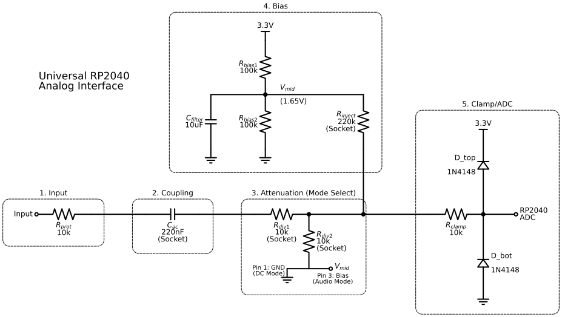

# Hardware: Universal RP2040 Signal Conditioning Interface

**Version:** v0 prototype | **Status:** Built and validated

This directory contains the schematic, board layout and bill of materials for the analog front end (AFE): the circuit between the input jack and the RP2040's ADC. Audio signals (Eurorack, line level, guitar) swing above and below 0V, while the ADC only reads 0 to 3.3V. The AFE scales the signal down, shifts it up to the middle of that range, and protects the ADC from overvoltage.

## Schematic & Theory of Operation

The circuit has five stages, described in signal order below.

*See [`exports/`](./exports/) for PDF versions and the compact schematic view.*

### 1. Input Protection

**Component:** $R_{prot}$ ($10k\Omega$)

A $10k\Omega$ resistor sits in series right at the input jack. If the input sees a voltage spike or is accidentally connected to a modular synth power rail ($\pm 12V$), this resistor limits the current into the clamping diodes (stage 5) so they don't burn out.

### 2. AC Coupling (High-Pass Filter)

**Component:** $C_{ac}$ ($220nF$)

A series capacitor blocks any DC offset from the source, so the full 3.3V range is available for the audio signal. I used a $220nF$ polyester film capacitor. The corner frequency ($f_c$) depends on the input impedance of the next stage.

In **High-Z / Guitar Mode**, where input impedance is dominated by $R_{inject}$ ($220k\Omega$):
$$f_c = \frac{1}{2\pi R C} = \frac{1}{2\pi \cdot 220k\Omega \cdot 220nF} \approx 3.29 Hz$$

That keeps the response flat well below 20Hz, the bottom of the audible range. The attenuating modes have a lower input impedance and so a higher corner frequency.

### 3. Attenuation & Mode Selection

**Components:** $R_{div1}$, $R_{div2}$, Jumper Header

This stage sets how much the signal is scaled down. $R_{div1}$ and $R_{div2}$ are socketed, so the attenuation ratio ($A_v$) can be changed for each source (for example 0.1× for modular synths, 0.5× for line level).

The bottom of the divider connects to a jumper-selected reference (a **switched reference**). My first version tied $R_{div2}$ to ground and added the bias separately, but the divider then pulled the bias voltage down.

- **Audio Mode:** The jumper connects the bottom of $R_{div2}$ to $V_{mid}$ ($1.65V$). The divider then scales the signal around 1.65V instead of around ground, so the bias stays put and the ratio is unchanged.
- **DC Mode:** The jumper connects to GND, forming a standard resistive divider for unipolar sensing (0-5V sensors).

### 4. Bias Network

**Components:** $R_{bias1}$, $R_{bias2}$, $C_{filter}$, $R_{inject}$

To read signals that swing both ways, the ADC needs them centered at $1.65V$ (half of 3.3V). A divider of two $100k\Omega$ resistors, filtered by a $10\mu F$ electrolytic capacitor, makes this quiet mid-rail voltage ($V_{mid}$).

- **For High-Impedance Instruments (guitar):** Leave the attenuator sockets empty and install $R_{inject}$ ($220k\Omega$), which biases the signal without loading the guitar pickups.
- **For Line Sources:** Remove $R_{inject}$; the switched reference from stage 3 provides the bias.

### 5. Clamping & ADC Driver

**Components:** $D_{top}$, $D_{bot}$, $R_{clamp}$

The last stage protects the microcontroller. Two 1N4148 diodes clamp the signal to the supply rails, plus one diode drop (about $-0.3V$ to $3.6V$). A final $10k\Omega$ resistor ($R_{clamp}$) limits the current into the ADC pin, protecting against latch-up (a damaging fault state) if the diodes can't fully absorb a spike.

---

## Bill of Materials (BOM)

### Passive Components

| Schematic Ref | Value | Component Type | Stock SKU | Price (Unit) | Notes |
| :--- | :--- | :--- | :--- | :--- | :--- |
| **$R_{prot}$** | 10kΩ | Resistor 1/4W 1% | **A-2203** | \$0.015 | Input protection. |
| **$C_{ac}$** | 220nF | Polyester Box Cap | **A-565** | \$0.14 | **Socket This.** Audio coupling. Swap for Wire in DC mode. |
| **$R_{div1}$** | 10kΩ | Resistor 1/4W 1% | **A-2203** | \$0.015 | **Socket This.** Top of attenuator. |
| **$R_{div2}$** | 10kΩ | Resistor 1/4W 1% | **A-2203** | \$0.015 | **Socket This.** Bottom of attenuator. |
| **$R_{inject}$** | 220kΩ | Resistor 1/4W 1% | **A-2329** | \$0.015 | **Socket This.** Only used in High-Z / Guitar Mode. |
| **$R_{bias1}$** | 100kΩ | Resistor 1/4W 1% | **A-2248** | \$0.015 | Top of bias divider (3.3V). |
| **$R_{bias2}$** | 100kΩ | Resistor 1/4W 1% | **A-2248** | \$0.015 | Bottom of bias divider (GND). |
| **$C_{filter}$** | 10µF | Electrolytic Cap | **A-4554** | \$0.02 | Filters the $V_{mid}$ rail. Watch Polarity! |
| **$R_{clamp}$** | 10kΩ | Resistor 1/4W 1% | **A-2203** | \$0.015 | Final current limiter before ADC. |
| **$D_{top}$** | 1N4148 | Switching Diode | **A-157** | \$0.01 | Clamps signal to 3.3V. |
| **$D_{bot}$** | 1N4148 | Switching Diode | **A-157** | \$0.01 | Clamps signal to GND. |

### Hardware & Connectors

| Component | Description | Stock SKU | Price (Unit) | Usage |
| :--- | :--- | :--- | :--- | :--- |
| **RP2040-Zero** | Raspberry Pi Module | **A-8128** | \$2.29 | Microcontroller with the ADC. |
| **Input Jack** | 6.35mm (1/4") Mono Socket | **A-4556** | \$0.77 | Main signal input. |
| **SIP Sockets** | 40 Pin SIP Socket Adaptor | **A-1605** | \$0.39 | Cut to size for socketed components ($R_{div}$, $C_{ac}$). |
| **Mode Jumper** | 3-Pin Male Header + Shunt | *Generic* | N/A | Selector for Audio ($V_{mid}$) vs DC (GND). |
| **Perfboard** | 40x60mm Double Sided | **A-1193** | \$0.40 | Main substrate. |

#### Project Total: $4.14

### Socket Breakdown

Cut the 40-pin socket strip into these sections for the swappable parts:

- **1x2 Pin:** For $C_{ac}$
- **1x2 Pin:** For $R_{div1}$
- **1x2 Pin:** For $R_{div2}$
- **1x2 Pin:** For $R_{inject}$

---

## Configuration Guide

The board's mode is set by the socketed parts and the position of the 3-pin jumper.

| Mode | Application | Jumper (JP1) | $R_{div1}/R_{div2}$ | $R_{inject}$ |
| :--- | :--- | :--- | :--- | :--- |
| **Audio (Std)** | Synths, Pedals | Pin 2-3 ($V_{mid}$) | 10k / 10k | *Empty* |
| **Guitar (High-Z)** | Passive Inst. | Pin 2-3 ($V_{mid}$) | Wire / *Empty* | 220k |
| **DC / Sensor** | 0-5V Signals | Pin 1-2 (GND) | 10k / 10k | *Empty* |

## Assembly & Calibration Notes

1. **Ground Loops:** If connecting to mains-powered gear (like guitar pedalboards), power the RP2040 from an isolated laptop (battery mode) to avoid creating a ground loop with the building mains.
1. **Diodes:** Observe polarity. The **Black Band** (Cathode) on $D_{top}$ points to 3.3V. The **Black Band** on $D_{bot}$ points to the Signal Line.
1. **Electrolytic Cap:** The **White Stripe** (Negative) on $C_{filter}$ must connect to Ground.
1. **RP2040 Installation:** Push the headers into a breadboard first, place the RP2040 on top, and solder. This keeps the pins straight and aligned.

### Sample Rate Calibration

The RP2040's clock is stable, but the sample rate is set by how long each pass of the MicroPython loop takes, so it has to be measured. To estimate the sample rate ($F_s$) without a function generator:

1. Touch the tip of the input jack to couple 60Hz mains hum from the environment.
1. Capture a burst and compute its spectrum (`calibration.calibrate_fs_robust` does this step and the next two).
1. Measure the offset of the peak from 60.0Hz.
1. Multiply the assumed sample rate by $\alpha = \frac{60.0}{f_{meas}}$.

*For this specific build, the mains method gave $F_s = 97.86 kHz$, $0.18\%$ high. Mains hum is a weak reference for one short burst; verifying against crystal-referenced sound-card tones (`calibration.calibrate_fs_with_tone`) gives $F_s = 97.69 kHz \pm 0.01\%$. See Notebook `02`, Section 5b.*
